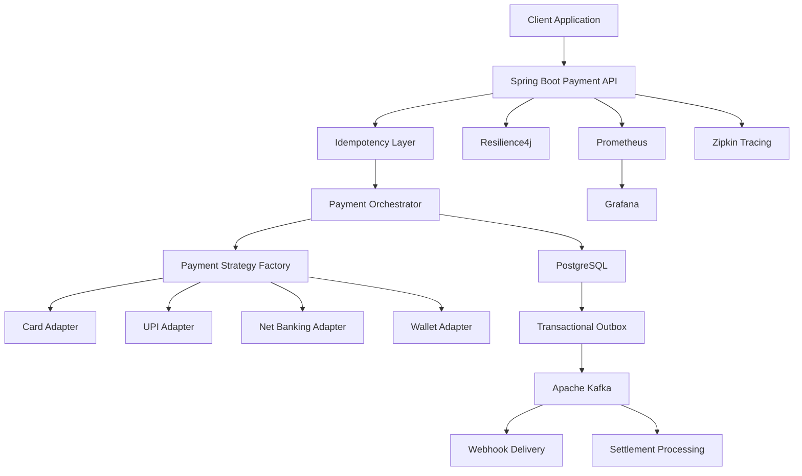

# Razorpay Clone — Distributed Payment Gateway

A Spring Boot–based payment gateway inspired by Razorpay, designed to explore secure payment processing, distributed transaction management, idempotency, asynchronous messaging, and scalable backend architecture.

The project focuses on building reliable payment workflows using Java, Spring Boot, PostgreSQL, Kafka, Redis, and cloud-native infrastructure.

> **Disclaimer:** This is an independent learning project inspired by payment gateway architectures. It is not affiliated with or endorsed by Razorpay and does not process real payments unless explicitly integrated with an authorized payment provider.

## Key Features

- **Pluggable Payment Processing:** Strategy-pattern-based adapters for Card, UPI, Net Banking, and Wallet payment methods.
- **Secure Card Data Handling:** AES-256 envelope-encryption design using Spring Security Crypto for sensitive payment data.
- **Distributed Transaction Management:** Saga-pattern workflows and the Transactional Outbox pattern for coordinating database updates and asynchronous events.
- **Idempotent Payment APIs:** Redis-based `SETNX` idempotency controls to prevent duplicate payment processing during retries.
- **Resilience and Fault Tolerance:** Resilience4j circuit breakers and failure-simulation scenarios.
- **Webhook Delivery Engine:** HMAC-SHA256 signatures, exponential-backoff retries, and dead-letter queue (DLQ) handling.
- **Settlement Processing:** Spring Batch workflows for calculating merchant settlements and reconciling transactions.
- **Observability:** Prometheus metrics, Grafana dashboards, and Zipkin distributed tracing.
- **Cloud-Native Scalability:** Kubernetes deployment architecture with Horizontal Pod Autoscaler (HPA) support.

## Architecture Overview

The gateway separates payment orchestration, payment-method execution, persistence, asynchronous event processing, and operational monitoring.



*Conceptual architecture; components and integrations should reflect the implementation currently available in the repository.*

## Technology Stack

| Category | Technologies |
|---|---|
| Language | Java |
| Backend Framework | Spring Boot, Spring Framework |
| Security | Spring Security Crypto, AES-256, HMAC-SHA256 |
| Database | PostgreSQL |
| Messaging | Apache Kafka |
| Caching and Idempotency | Redis |
| Resilience | Resilience4j |
| Batch Processing | Spring Batch |
| Containerization | Docker |
| Orchestration | Kubernetes, HPA |
| Load Testing | Apache JMeter |
| Monitoring | Prometheus, Grafana |
| Distributed Tracing | Zipkin |
| Build Tool | Maven |

## Core Engineering Concepts

### 1. Strategy Pattern for Payment Methods

The payment layer uses a common abstraction for different payment methods, allowing new adapters to be introduced without changing the payment orchestration logic.

Potential benefits:
- Reduced coupling between payment orchestration and individual adapters.
- Easier testing of payment-method-specific behavior.
- Extensibility for additional payment methods.

### 2. Idempotent Payment Processing

Payment APIs must handle retries safely. A client may resend a request after a timeout even if the original request was already processed.

The idempotency layer uses Redis `SETNX` to atomically claim an idempotency key before processing a request.

The intended workflow is:

1. Receive a payment request with an idempotency key.
2. Atomically claim the key.
3. Process the payment or identify an existing request.
4. Persist the payment outcome.
5. Return the existing result for eligible duplicate requests.

**Important:** Reliable idempotency also requires handling key expiration, concurrent requests, processing failures, and recovery of incomplete operations.

### 3. Saga Pattern and Transactional Outbox

Distributed payment workflows can involve multiple services and databases that cannot participate in a single local database transaction.

The Saga pattern coordinates multi-step operations and compensating actions where appropriate.

The Transactional Outbox pattern records an event in the same database transaction as the corresponding business update. A separate publisher then forwards the event to Kafka.

This design helps prevent database updates and event publication from becoming inconsistent. Consumers must still handle duplicate delivery, and outbox publishing and recovery must be implemented correctly to provide reliable processing.

### 4. Secure Payment Data Handling

The card-data protection design uses AES-256 envelope encryption and Spring Security Crypto.

Security considerations include:
- Avoiding card data in application logs.
- Minimizing the lifetime of sensitive data in memory.
- Restricting access to encryption keys.
- Protecting secrets and database credentials.
- Applying appropriate data-retention and access-control policies.

**Compliance note:** Using encryption does not by itself establish PCI DSS compliance. Any claim of PCI compliance requires an assessment of the complete system, operational controls, and applicable compliance requirements. This project should not be represented as PCI-certified without supporting evidence.

### 5. Webhook Delivery and Retry Handling

The webhook subsystem is designed to notify merchant applications of payment events.

Key capabilities include:
- HMAC-SHA256 request signing.
- Exponential-backoff retry scheduling.
- Dead-letter queue handling for exhausted retries.
- Controlled replay of failed webhook deliveries.

Webhook consumers should verify signatures, reject invalid requests, and safely handle repeated event delivery.

### 6. Settlement and Reconciliation

Spring Batch is used for scheduled settlement-processing workflows.

The intended responsibilities include:
- Grouping transactions by merchant.
- Calculating settlement amounts.
- Accounting for applicable fees, refunds, and adjustments.
- Identifying mismatches for reconciliation.
- Recording settlement results for auditing.

## Reliability and Performance Testing

The project includes an intended testing approach for evaluating throughput, failure handling, and system reliability.

| Area | Validation approach |
|---|---|
| API throughput | Apache JMeter load tests |
| Duplicate requests | Concurrent idempotency tests |
| Database and messaging consistency | Outbox recovery and duplicate-event tests |
| Failure handling | Circuit-breaker and dependency-failure simulations |
| Webhook delivery | Retry, signature-verification, and DLQ tests |
| Horizontal scaling | Kubernetes HPA behavior under load |
| Observability | Metrics, dashboards, and distributed traces |

If the benchmark has been executed and reproduced, document the actual results here:

- **Peak throughput:** [Measured requests or transactions per second]
- **Test duration:** [Duration]
- **Concurrent virtual users:** [Number]
- **Error rate:** [Measured percentage]
- **Latency:** [p50, p95, and p99]
- **Deployment configuration:** [CPU, memory, replicas, and environment]

A target of 10,000 transactions per second should be presented as a verified benchmark only when the test results, workload, environment, and definition of a successful transaction are documented.

## Getting Started

### Prerequisites

Install the following tools as required by the implemented project:

- Java version compatible with the project configuration
- Maven
- Git
- Docker, if using containerized services
- PostgreSQL, Redis, and Kafka, if required by the application

### Clone the Repository

```bash
git clone https://github.com/seemaamola/razorpayclone.git
cd razorpayclone
```

### Build the Project

On macOS or Linux:

```bash
./mvnw clean package
```

On Windows:

```bash
mvnw.cmd clean package
```

### Run the Application

```bash
./mvnw spring-boot:run
```

Configure the required database, messaging, and cache dependencies before starting the application. Use the project's actual configuration files to determine which services and environment variables are required.

### Run Tests

```bash
./mvnw test
```

These commands assume the Maven wrapper and corresponding build configuration are set up correctly in the repository.

## Project Structure

The application follows a Maven project layout. A possible logical organization for the payment gateway is:

```text
razorpayclone/
├── src/
│   ├── main/
│   │   ├── java/
│   │   │   └── .../
│   │   │       ├── controller/
│   │   │       ├── service/
│   │   │       ├── payment/
│   │   │       ├── repository/
│   │   │       ├── security/
│   │   │       ├── webhook/
│   │   │       └── settlement/
│   │   └── resources/
│   └── test/
├── pom.xml
├── mvnw
└── README.md
```

*Illustrative structure only; adjust it to match the actual package names and directories in the repository.*

## Future Enhancements

- Add a comprehensive integration-test suite using Testcontainers.
- Publish OpenAPI documentation for payment APIs.
- Add a reproducible JMeter benchmark report.
- Implement reconciliation dashboards and payment lifecycle monitoring.
- Add automated CI/CD workflows and container-image security scanning.
- Document deployment manifests, failure-recovery procedures, and architecture decisions.

## Learning Outcomes

This project explores practical backend engineering concepts:

- Designing extensible payment-processing abstractions.
- Building REST APIs with Java and Spring Boot.
- Managing transaction consistency across PostgreSQL and Kafka.
- Implementing idempotency and retry-safe workflows.
- Applying security controls to sensitive payment data.
- Testing fault tolerance and application performance.
- Designing observable and scalable distributed services.

## Author

**Seema Amola**

GitHub: [@seemaamola](https://github.com/seemaamola)

Project repository: [razorpayclone](https://github.com/seemaamola/razorpayclone)
